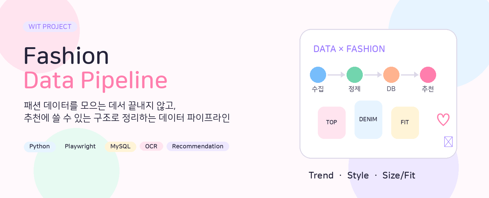
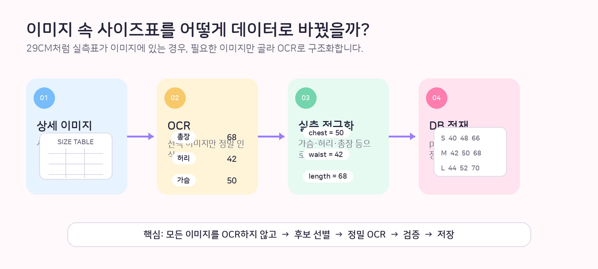
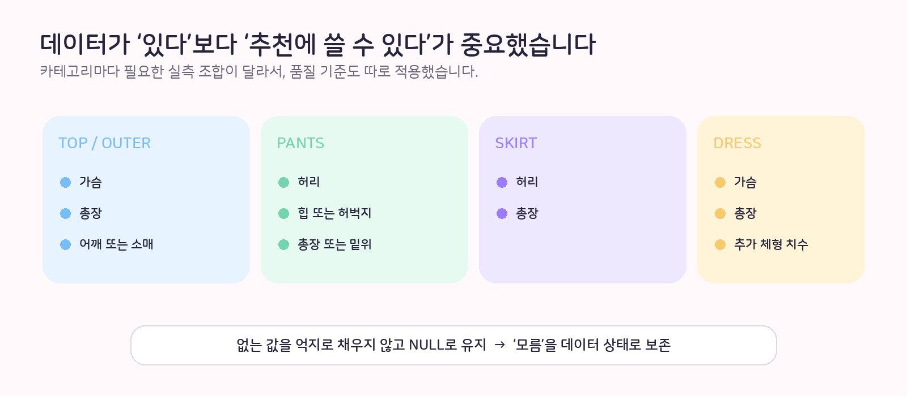
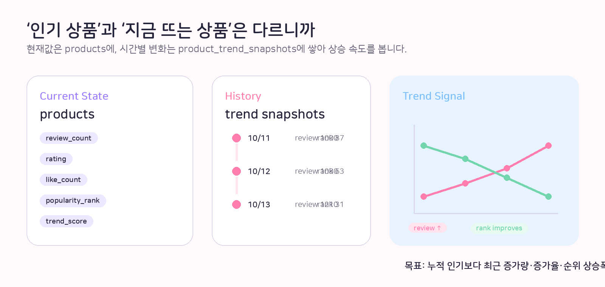
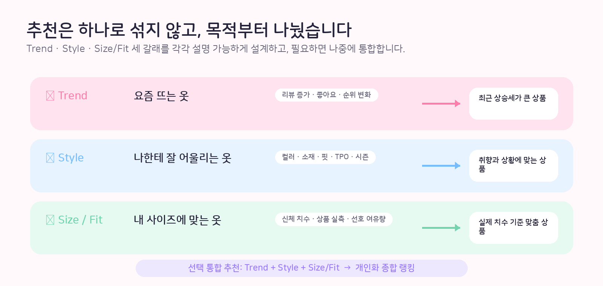

<div align="center">



<br>

### 여러 패션 플랫폼에 흩어진 상품 데이터를  
### **추천에 바로 쓸 수 있는 구조화 데이터**로 만드는 프로젝트

<br>

[](https://www.python.org/)
[](https://playwright.dev/python/)
[](https://www.mysql.com/)
[](https://github.com/tesseract-ocr/tesseract)

[🌷 Overview](#-project-overview) ·
[🧭 Architecture](#-architecture) ·
[🔎 Pipeline](#-what-i-built) ·
[🔥 Trend](#-trend-recommendation) ·
[👗 Style](#-style-recommendation) ·
[📏 Fit](#-size--fit-recommendation) ·
[🗄️ DB](#️-database) ·
[🔗 Code](#-quick-links)

</div>

---

## 🌷 Project Overview

패션 데이터는 생각보다 제각각입니다.

같은 **사이즈**, **리뷰**, **상품 속성**을 다루더라도  
플랫폼마다 제공 방식이 다르고, 어떤 값은 API에 있고 어떤 값은 이미지 안에만 있습니다.

그래서 이 프로젝트에서는 단순히 “크롤링해서 많이 쌓기”보다,

> **이 데이터를 실제 추천에 쓸 수 있는가?**

를 기준으로 파이프라인을 설계했습니다.

### 한 줄로 정리하면

**Collection → Validation → Normalization → History → Recommendation**

상품을 찾고, 검증하고, 공통 구조로 바꾸고, 변화 이력을 남긴 뒤  
**Trend / Style / Size-Fit** 추천으로 연결합니다.

---

## ✨ Project Snapshot

| 항목 | 수집 예시 |
|---|---:|
| 👕 상품 데이터 | **4,943건** |
| 🖼️ 상품 이미지 | **34,122장** |
| 📏 사이즈 정보 | **15,677건** |
| 🏷️ 브랜드 | **954개** |

> 운영 당시 수집 현황 예시이며, 공개 저장소에는 실제 원본 데이터는 포함하지 않습니다.

---

## 🧭 Architecture

### 추천 서비스까지 어떻게 연결되는지 한 장으로 보기

아래 이미지는 프로젝트의 **서비스 확장 구조**를 정리한 아키텍처입니다.


> **Portfolio note**  
> 위 시각화의 Zigzag / Ably는 확장 설계에 포함된 플랫폼입니다.  
> 현재 공개 저장소의 실제 구현 코드는 **MUSINSA + 29CM 중심**으로 정리되어 있습니다.

---

## 💡 What I Built

### 01. 플랫폼별 상품 수집

- MUSINSA 상품 탐색 및 상세 데이터 수집
- 29CM 상품 수집
- Playwright를 이용한 동적 페이지 대응
- 플랫폼별 데이터를 공통 DB 구조로 연결

**바로 보기**

- [MUSINSA mass collector](./collectors/musinsa_mass_pipeline.py)
- [MUSINSA continuous collector](./collectors/musinsa_mass_continuous.py)
- [29CM collector](./collectors/cm29_http_fast.py)

---

### 02. 상품 데이터를 공통 구조로 정규화

플랫폼마다 이름이 달라도 추천 단계에서는 같은 의미로 사용할 수 있어야 합니다.

```text
productName
itemName
goods_name
     ↓
product_name
```

그래서 플랫폼별 수집 로직과  
공통 데이터 적재/정규화 로직을 분리했습니다.

- [Common loader](./loaders/loader.py)
- [MUSINSA loader](./loaders/musinsa_mass_loader.py)

---

## 📏 이미지 속 사이즈표까지 데이터로

29CM처럼 실측표가 이미지 안에 있는 경우가 있습니다.



모든 상세 이미지를 무조건 OCR하지 않고,

**후보 이미지 탐색 → 선택 이미지 정밀 OCR → 실측값 검증 → DB 저장**

순서로 처리했습니다.

### 왜 이렇게 했나?

모든 이미지를 OCR하면 불필요한 처리량이 커지고  
정작 필요한 사이즈표보다 다른 상세 이미지가 훨씬 많기 때문입니다.

- [29CM OCR worker](./enrichers/cm29_ocr_worker.py)
- [OCR console worker](./ocr_console/worker.py)
- [OCR image utilities](./ocr_console/images.py)

---

## ✅ Data Quality

실측값이 하나 있다고 해서 바로 추천 가능한 상품으로 보지 않았습니다.



카테고리별로 중요한 치수가 다르기 때문에  
각 상품군에 필요한 최소 실측 조합을 따로 검증합니다.

또한 값이 없을 때는 임의의 숫자를 만들어 채우지 않고 `NULL`로 유지합니다.

> **NULL = 오류가 아니라, 현재 확보하지 못한 정보라는 상태**

- [Quality audit](./quality/audit_product_quality.py)

---

## 🔥 Trend Recommendation

누적 리뷰가 많은 상품과  
**지금 빠르게 뜨는 상품**은 다릅니다.



그래서 현재값과 과거 이력을 분리했습니다.

### `products` — 현재 상태

```text
review_count
rating
like_count
sales_count
popularity_rank
ranking_context
trend_score
trend_updated_at
```

### `product_trend_snapshots` — 시간별 이력

```text
product_id
captured_at
review_count
rating
like_count
sales_count
popularity_rank
ranking_context
```

이 구조를 기반으로 다음 지표를 계산할 수 있습니다.

- 24시간 리뷰 증가량
- 7일 리뷰 증가율
- 좋아요 증가속도
- 판매량 증가속도
- 인기순위 상승폭
- 신상품 가중치

즉, 단순히 **“제일 유명한 상품”**보다  
**“최근 반응이 가장 빠르게 올라오는 상품”**을 찾는 것이 목표입니다.

---

## 👗 Style Recommendation

스타일 추천은 단순 카테고리 일치보다  
상품의 세부 속성을 구조화해서 활용하는 방향으로 설계했습니다.

```text
Color
Material
Fit
Silhouette
Pattern
Neckline
Season
TPO
Style Tags
```

예를 들어 같은 니트라도

```text
KNIT
├── Fit
│   ├── Slim
│   ├── Regular
│   └── Oversized
├── Neckline
│   ├── Round
│   ├── V-Neck
│   └── Turtle Neck
└── Style
    ├── Casual
    ├── Minimal
    └── Office
```

처럼 속성을 나눠서  
**왜 이 상품을 추천했는지 설명 가능한 추천**으로 확장하는 것이 목표입니다.

---

## 📏 Size / Fit Recommendation

같은 `M` 사이즈라도 브랜드와 상품마다 실제 크기는 다를 수 있습니다.

그래서 사이즈 이름보다 **실제 의류 치수**를 중심으로 설계합니다.

```text
User Body Measurements
        +
Garment Measurements
        +
Category
        +
Preferred Ease
        ↓
      Fit Score
```

사용자가 선호하는 핏도 반영할 수 있습니다.

- Slim
- Regular
- Relaxed
- Oversized

---

## 🎀 Three Recommendation Tracks



Trend / Style / Size-Fit을 처음부터 하나의 점수로 섞지 않았습니다.

각 추천의 목적과 근거를 따로 유지한 뒤,  
추후 필요하면 **통합 랭킹**으로 결합할 수 있도록 설계했습니다.

---

## 🗄️ Database

### Main Tables

| Table | 역할 |
|---|---|
| `products` | 상품 최신 상태와 추천 속성 |
| `product_sizes` | 사이즈별 실제 의류 실측 |
| `product_images` | 상품 이미지 정보 |
| `product_models` | 모델 착용 관련 정보 |
| `product_trend_snapshots` | 인기 지표의 시간 변화 |

[📄 전체 DB Schema 보기](./sql/schema.sql)

---

## 📂 Project Structure

```text
fashion-data-pipeline/
│
├── collectors/          # 플랫폼별 상품 수집
├── core/                # 공통 설정 / 공용 로직
├── loaders/             # 데이터 정규화 및 MySQL 적재
├── enrichers/           # OCR / 이미지 / 추가 정보 보강
├── quality/             # 데이터 품질 검증
├── ocr_console/         # OCR Queue / Worker
├── pipelines/           # 반복 실행 Shell Script
├── sql/
│   └── schema.sql
├── assets/              # Portfolio visuals
├── .env.example
├── requirements.txt
└── README.md
```

---

## 🔗 Quick Links

| 영역 | 코드 |
|---|---|
| 🛍️ MUSINSA 수집 | [musinsa_mass_pipeline.py](./collectors/musinsa_mass_pipeline.py) |
| 🔄 MUSINSA 반복 수집 | [musinsa_mass_continuous.py](./collectors/musinsa_mass_continuous.py) |
| 🛒 29CM 수집 | [cm29_http_fast.py](./collectors/cm29_http_fast.py) |
| 🔎 OCR 처리 | [cm29_ocr_worker.py](./enrichers/cm29_ocr_worker.py) |
| 📥 DB 적재 | [loader.py](./loaders/loader.py) |
| ✅ 품질 검증 | [audit_product_quality.py](./quality/audit_product_quality.py) |
| 🗄️ DB Schema | [schema.sql](./sql/schema.sql) |
| ⚙️ Pipeline scripts | [pipelines/](./pipelines/) |

---

## 🛠️ Tech Stack

| Area | Technology |
|---|---|
| Language | Python · SQL · Bash |
| Browser Automation | Playwright |
| HTTP / Parsing | Requests · BeautifulSoup |
| Database | MySQL · PyMySQL |
| OCR | Tesseract OCR |
| Image Processing | Pillow |
| Infrastructure | Linux / Ubuntu |
| Cloud SDK | OCI |

---

## 🧠 Engineering Decisions

### 01. 플랫폼 수집과 추천 데이터 구조를 분리
새 플랫폼이 추가돼도 추천 계층 전체를 다시 만들지 않도록 했습니다.

### 02. Structured Data First
API/HTML에서 구조화된 값을 얻을 수 있으면 OCR보다 먼저 사용합니다.

### 03. OCR is a Fallback
이미지에만 실측표가 있을 때 OCR을 사용합니다.

### 04. Preserve Uncertainty
없는 값을 임의로 채우지 않습니다.

### 05. Current State ≠ Trend
현재 인기와 상승 추세를 구분하기 위해 snapshot을 별도로 저장합니다.

---

## 🛣️ Roadmap

### 완료

- [x] MUSINSA 상품 수집
- [x] 상품 실측 데이터 적재
- [x] 29CM 상품 수집
- [x] OCR Worker
- [x] 데이터 품질 검증
- [x] MySQL 정규화
- [x] Trend Snapshot Schema

### 확장

- [ ] Trend Score 고도화
- [ ] Fashion Ontology 확장
- [ ] 이미지 기반 Style Attribute 추출
- [ ] User Body Profile
- [ ] Category별 Ease Rule
- [ ] Fit Score
- [ ] Style Matching
- [ ] Recommendation API
- [ ] Dashboard

---

## ⚙️ Setup

```bash
git clone https://github.com/mepics2425-prog/fashion-data-pipeline.git
cd fashion-data-pipeline

python -m venv .venv
source .venv/bin/activate

pip install -r requirements.txt
python -m playwright install chromium

cp .env.example .env
```

DB 구조는 [`sql/schema.sql`](./sql/schema.sql)로 재현할 수 있습니다.

---

## 🔐 Repository Policy

공개 저장소에는 다음 정보를 포함하지 않습니다.

- 실제 DB 비밀번호
- API Key
- SSH Key
- `.env`
- 운영 서버 주소
- 실제 사용자 정보
- 대규모 원본 데이터

---

<div align="center">

### 🌸 Data를 많이 모으는 것보다,  
### **추천에 쓸 수 있게 만드는 것**에 집중했습니다.

<br>

[⬆ Back to top](#fashion-data-pipeline)

</div>
