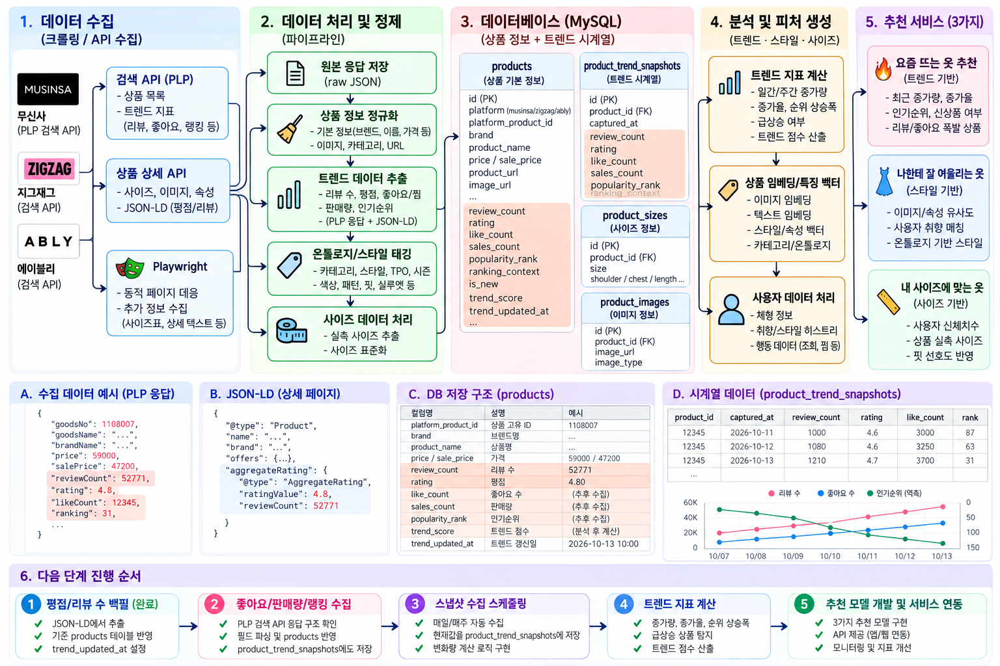
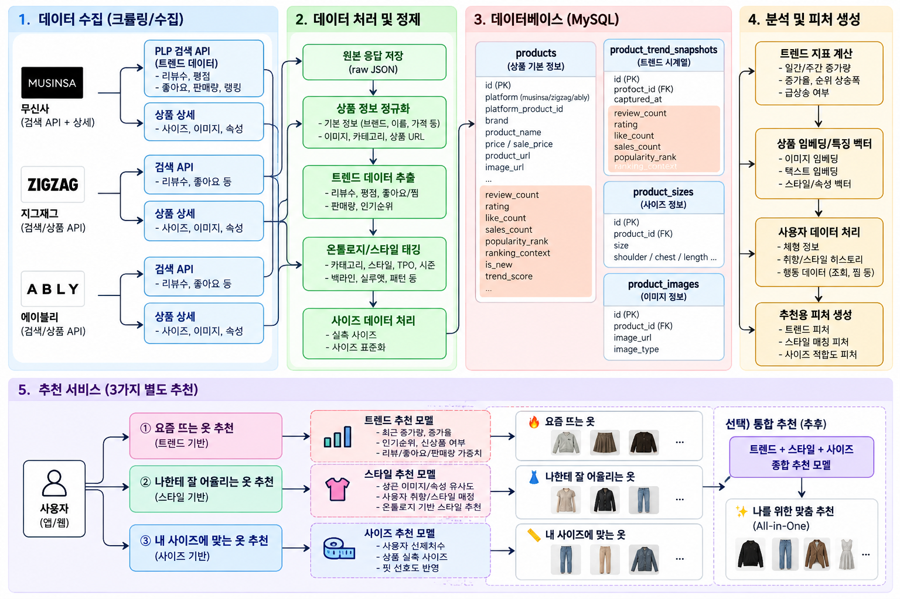

<div align="center">

# 👗 Fashion Data Pipeline

### 멀티 패션 플랫폼 데이터를 수집·정제·구조화해  
### **Trend · Style · Size/Fit 추천으로 연결하는 데이터 파이프라인**

<br>


<br>

**흩어진 패션 데이터를 추천에 바로 쓸 수 있는 데이터로 만드는 프로젝트**

[🌷 프로젝트 소개](#-project-overview) ·
[🧭 전체 구조](#-architecture) ·
[📦 데이터 파이프라인](#-data-pipeline) ·
[🔥 트렌드 추천](#-trend-recommendation) ·
[👗 스타일 추천](#-style-recommendation) ·
[📏 사이즈 추천](#-size--fit-recommendation) ·
[🗄️ DB](#️-database) ·
[🛠️ 기술 스택](#️-tech-stack)

</div>

---

## 🌷 Project Overview

패션 플랫폼은 같은 의류를 다루더라도 제공하는 데이터 구조가 서로 다릅니다.

어떤 플랫폼은 상품 정보를 API 형태로 제공하고,  
어떤 상품은 상세 이미지 안에 사이즈표가 들어 있으며,  
리뷰·평점·좋아요·랭킹처럼 **트렌드를 판단하는 데이터도 플랫폼마다 형태가 다릅니다.**

그래서 이 프로젝트에서는 단순히 크롤링 결과를 쌓는 것보다,

> **수집한 데이터를 추천 서비스에 바로 활용할 수 있는 구조로 만드는 것**

을 목표로 했습니다.

### 이 프로젝트가 해결하려는 것

- 여러 패션 플랫폼의 상품 정보를 하나의 구조로 정리
- 실제 의류 실측값을 Size/Fit 추천에 활용
- 리뷰·평점·좋아요·순위 변화를 시계열로 저장
- 컬러·소재·핏·실루엣·TPO 등의 속성을 스타일 추천에 활용
- 데이터 누락과 오류를 검증한 뒤 DB에 적재
- 최종적으로 3개의 독립 추천 서비스로 확장

---

## 🧭 Architecture

### 전체 데이터 수집 → 정제 → DB → 추천 구조

아래 이미지는 이 프로젝트의 전체 데이터 흐름을 정리한 아키텍처입니다.



<br>

### 추천 서비스 구조

추천은 하나의 점수로 모두 섞지 않고 목적에 따라 분리했습니다.



---

## 🎯 Recommendation Goal

| 추천 서비스 | 사용자에게 답하는 질문 | 주요 데이터 |
|---|---|---|
| 🔥 **Trend** | 요즘 실제로 뜨는 옷은 무엇인가? | 리뷰 증가량, 좋아요, 판매량, 인기순위, 신상품 여부 |
| 👗 **Style** | 나한테 어떤 스타일이 잘 어울리는가? | 컬러, 소재, 핏, 실루엣, 패턴, TPO, 시즌 |
| 📏 **Size / Fit** | 실제 내 몸에 맞는 옷은 무엇인가? | 사용자 신체 치수, 상품 실측값, 선호 핏 |

> 세 추천 결과는 독립적으로 제공할 수 있고,  
> 추후에는 **Trend + Style + Size/Fit**을 조합한 통합 추천으로 확장할 수 있도록 설계했습니다.

---

## 📦 Data Pipeline

### 01. 상품 탐색

플랫폼의 검색/상품 목록에서 수집 대상 상품을 찾습니다.

**수집 항목**

- Platform Product ID
- 상품명
- 브랜드
- 가격
- 성별
- 카테고리
- 대표 이미지
- 상품 URL

**Code**

- [MUSINSA Mass Collector](./collectors/musinsa_mass_pipeline.py)
- [MUSINSA Continuous Collector](./collectors/musinsa_mass_continuous.py)
- [29CM Collector](./collectors/cm29_http_fast.py)

---

### 02. 상품 상세 데이터 수집

상품 상세 단계에서는 추천에 필요한 데이터를 더 세밀하게 수집합니다.

```text
Product
├── Brand
├── Product Name
├── Category
├── Gender
├── Price
├── Color
├── Material
├── Fit
├── Stretch
├── Thickness
├── Images
└── Size Measurements
```

---

### 03. 데이터 정규화

플랫폼마다 필드 이름이 달라도  
DB에서는 동일한 컬럼으로 사용할 수 있도록 변환합니다.

```text
productName
itemName
goods_name
     ↓
product_name
```

이 덕분에 추천 로직은  
각 플랫폼의 내부 데이터 구조를 직접 알 필요가 없습니다.

**Code**

- [Common Loader](./loaders/loader.py)
- [MUSINSA Loader](./loaders/musinsa_mass_loader.py)

---

## 🛍️ Platform Strategy

### MUSINSA

MUSINSA는 **실제 의류 실측 데이터**를 확보하는 핵심 데이터 소스로 활용합니다.

수집 대상:

- 상품 기본정보
- 브랜드 / 카테고리
- 성별 / 가격
- 상품 이미지
- 컬러 / 소재 / 핏
- 평점 / 리뷰
- 사이즈별 실제 의류 치수

예를 들어 팬츠라면 단순히 `M`이라는 사이즈 이름만 저장하는 것이 아니라,

```text
허리
힙
허벅지
밑위
총장
```

처럼 실제 치수를 저장합니다.

---

### 29CM

29CM은 일부 상품의 사이즈표가  
구조화된 데이터가 아니라 **상세 이미지 안에 존재**할 수 있습니다.

그래서 구조화된 사이즈 데이터를 먼저 찾고,  
없는 경우에만 OCR 파이프라인으로 넘깁니다.

```text
상품 상세
   ↓
구조화된 실측 데이터 확인
   ↓
없음
   ↓
OCR Queue
   ↓
이미지 후보 탐색
   ↓
정밀 OCR
   ↓
실측값 검증
   ↓
DB 저장
```

#### 왜 모든 이미지를 OCR하지 않았나?

상품 하나에도 상세 이미지가 여러 장 존재하기 때문입니다.

모든 이미지를 정밀 OCR하면 처리량이 불필요하게 커지므로,

> **후보 탐색 → 사이즈표 가능성이 높은 이미지 선택 → 정밀 OCR**

순서로 처리합니다.

**Code**

- [29CM OCR Worker](./enrichers/cm29_ocr_worker.py)
- [OCR Worker](./ocr_console/worker.py)
- [OCR Image Utilities](./ocr_console/images.py)

---

## ✅ Data Quality

이 프로젝트에서는 **데이터 개수보다 추천에 실제 사용할 수 있는 데이터인지**를 더 중요하게 봅니다.

상품에 실측값 하나가 있다고 해서  
바로 추천 가능한 상품으로 판단하지 않습니다.

### 카테고리별 품질 기준 예시

| Category | Minimum Measurements |
|---|---|
| 👕 Top / Outer | 가슴 + 총장 + 어깨 또는 소매 |
| 👖 Pants | 허리 + 힙/허벅지 + 총장/밑위 |
| 👗 Dress | 가슴 + 총장 + 추가 체형 치수 |
| 🩳 Skirt | 허리 + 총장 |

누락된 값을 임의로 채우지 않고 `NULL`로 유지합니다.

`NULL`은 단순 오류가 아니라  
**현재 확보하지 못한 정보라는 상태값**으로 취급합니다.

**Code**

- [Data Quality Audit](./quality/audit_product_quality.py)

---

## 🔥 Trend Recommendation

단순히 리뷰가 많은 상품만 찾으면  
오랫동안 판매된 인기 상품이 계속 상위에 남을 수 있습니다.

그래서 이 프로젝트에서는 **현재값과 과거값을 분리**합니다.

### Current State

`products`

```text
review_count
rating
like_count
sales_count
popularity_rank
ranking_context
trend_score
trend_updated_at
```

### Historical State

`product_trend_snapshots`

```text
product_id
captured_at
review_count
rating
like_count
sales_count
popularity_rank
ranking_context
```

이를 이용하면 다음과 같은 지표를 만들 수 있습니다.

- 24시간 리뷰 증가량
- 7일 리뷰 증가율
- 좋아요 증가속도
- 판매량 증가속도
- 인기순위 상승폭
- 신상품 가중치

즉,

> **이미 유명한 상품**과  
> **지금 막 빠르게 뜨고 있는 상품**

을 구분하는 것이 목표입니다.

---

## 👗 Style Recommendation

스타일 추천은 단순히 카테고리가 같은 상품을 추천하는 것이 아니라  
상품의 세부 속성을 구조화하여 활용하는 방향으로 설계했습니다.

### Style Attributes

```text
Color
Material
Fit
Silhouette
Pattern
Neckline
Season
TPO
Style Tags
```

예:

```text
KNIT
├── Fit
│   ├── Slim
│   ├── Regular
│   └── Oversized
│
├── Neckline
│   ├── Round
│   ├── V-Neck
│   └── Turtle Neck
│
└── Style
    ├── Casual
    ├── Minimal
    └── Office
```

추후에는 사용자의 취향/상황과 연결해

> “비슷해서 추천”이 아니라  
> **“이런 속성 때문에 추천”**

이라고 설명할 수 있는 구조로 확장하는 것이 목표입니다.

---

## 📏 Size / Fit Recommendation

같은 `M` 사이즈라도 브랜드와 상품마다 실제 크기는 다를 수 있습니다.

그래서 Size/Fit 추천은  
사이즈 이름보다 **실제 Garment Measurement**를 중심으로 설계합니다.

```text
User Body Measurements
        +
Garment Measurements
        +
Category
        +
Preferred Fit
        ↓
      Fit Score
```

사용자의 선호 핏도 반영할 수 있습니다.

- Slim
- Regular
- Relaxed
- Oversized

즉, 같은 신체 치수라도  
사용자가 원하는 여유량에 따라 다른 상품을 추천할 수 있습니다.

---

## 🗄️ Database

### `products`

상품의 최신 상태와 추천용 속성을 저장합니다.

### `product_sizes`

상품별 실제 의류 실측값을 저장합니다.

### `product_images`

상품 이미지 관련 데이터를 저장합니다.

### `product_models`

모델 착용 정보 등 상품 모델 관련 데이터를 관리합니다.

### `product_trend_snapshots`

상품의 인기 지표 변화를 시간 단위로 저장합니다.

[📄 전체 DB Schema 보기](./sql/schema.sql)

---

## 📂 Project Structure

```text
fashion-data-pipeline/
│
├── collectors/          # 플랫폼별 상품 수집
├── core/                # 공통 설정 / 공용 로직
├── loaders/             # 데이터 정규화 및 MySQL 적재
├── enrichers/           # OCR / 이미지 / 추가 정보 보강
├── quality/             # 데이터 품질 검증
├── ocr_console/         # OCR Queue / Worker
├── pipelines/           # 반복 실행 Shell Script
├── sql/
│   └── schema.sql
├── assets/
│   ├── trend-pipeline-roadmap.png
│   └── recommendation-system-architecture.png
├── .env.example
├── requirements.txt
└── README.md
```

---

## 🔗 Quick Links

| 기능 | 바로가기 |
|---|---|
| 🛍️ MUSINSA 수집 | [musinsa_mass_pipeline.py](./collectors/musinsa_mass_pipeline.py) |
| 🔄 MUSINSA 반복 수집 | [musinsa_mass_continuous.py](./collectors/musinsa_mass_continuous.py) |
| 🛒 29CM 수집 | [cm29_http_fast.py](./collectors/cm29_http_fast.py) |
| 🔎 OCR 처리 | [cm29_ocr_worker.py](./enrichers/cm29_ocr_worker.py) |
| 📥 DB 적재 | [loader.py](./loaders/loader.py) |
| ✅ 품질 검증 | [audit_product_quality.py](./quality/audit_product_quality.py) |
| 🗄️ DB Schema | [schema.sql](./sql/schema.sql) |
| ⚙️ Pipeline Scripts | [pipelines/](./pipelines/) |

---

## 🛠️ Tech Stack

| Category | Technology |
|---|---|
| Language | Python · SQL · Bash |
| Browser Automation | Playwright |
| HTTP / Parsing | Requests · BeautifulSoup |
| Database | MySQL · PyMySQL |
| OCR | Tesseract OCR |
| Image Processing | Pillow |
| Infrastructure | Linux / Ubuntu |
| Cloud SDK | OCI |

---

## ⚙️ Setup

```bash
git clone https://github.com/mepics2425-prog/fashion-data-pipeline.git
cd fashion-data-pipeline

python -m venv .venv
source .venv/bin/activate

pip install -r requirements.txt
python -m playwright install chromium

cp .env.example .env
```

실제 운영 데이터는 공개 저장소에 포함하지 않습니다.

DB 구조는 [`sql/schema.sql`](./sql/schema.sql)로 다시 생성할 수 있습니다.

---

## 💡 Engineering Decisions

### 01. 플랫폼별 Collector와 공통 DB 구조를 분리

새로운 플랫폼이 추가되더라도  
추천 계층 전체를 다시 바꾸지 않아도 되도록 구성했습니다.

### 02. Structured Data First

가능하면 API/HTML의 구조화된 데이터를 우선 사용합니다.

### 03. OCR은 Fallback

이미지에만 존재하는 사이즈표에 OCR을 사용합니다.

### 04. 데이터 누락을 숨기지 않음

없는 데이터를 임의의 값으로 채우지 않습니다.

### 05. 현재 인기와 상승 추세를 분리

누적값만 저장하지 않고  
시간별 snapshot으로 변화량을 계산할 수 있도록 설계했습니다.

---

## 🛣️ Roadmap

### Data Pipeline

- [x] MUSINSA 상품 수집
- [x] 상품 실측 데이터 적재
- [x] 29CM 상품 수집
- [x] OCR Worker
- [x] 데이터 품질 검증
- [x] MySQL 정규화
- [x] Trend Snapshot Schema

### Recommendation

- [ ] Trend Score 고도화
- [ ] Fashion Ontology 확장
- [ ] Style Attribute 추출
- [ ] User Body Profile
- [ ] Category별 Ease Rule
- [ ] Fit Score
- [ ] Style Matching
- [ ] Recommendation API
- [ ] Dashboard

---

## 🔐 Repository Policy

이 공개 포트폴리오에는 다음 정보를 포함하지 않습니다.

- 실제 DB 비밀번호
- API Key
- SSH Key
- `.env`
- 운영 서버 주소
- 실제 사용자 정보
- 대규모 원본 데이터

---

## ✨ What I Focused On

이 프로젝트에서 가장 중요하게 본 것은  
**“데이터를 얼마나 많이 모았는가”가 아니라 “추천에 쓸 수 있는 데이터인가”**였습니다.

패션 데이터는 플랫폼마다 구조가 다르고,  
같은 상품 안에서도 정보가 누락될 수 있습니다.

그래서 단순 크롤링을 넘어

### `Collection → Validation → Normalization → History → Recommendation`

전체 흐름을 하나의 프로젝트로 연결했습니다.

<div align="center">

<br>

### 🌸 From fragmented fashion data  
### to recommendation-ready structured data.

<br>

[⬆ 맨 위로](#-fashion-data-pipeline)

</div>
