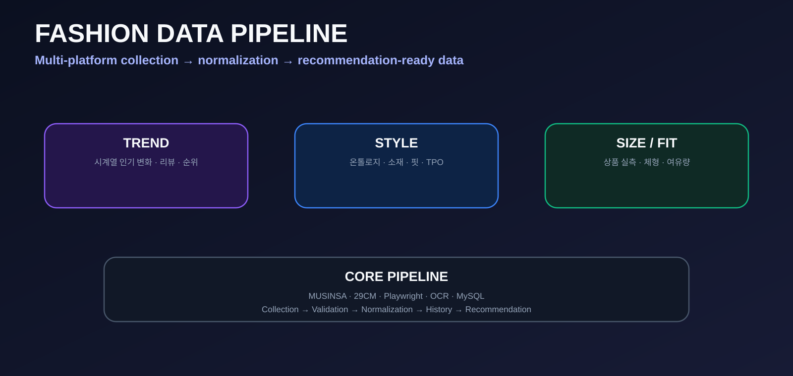
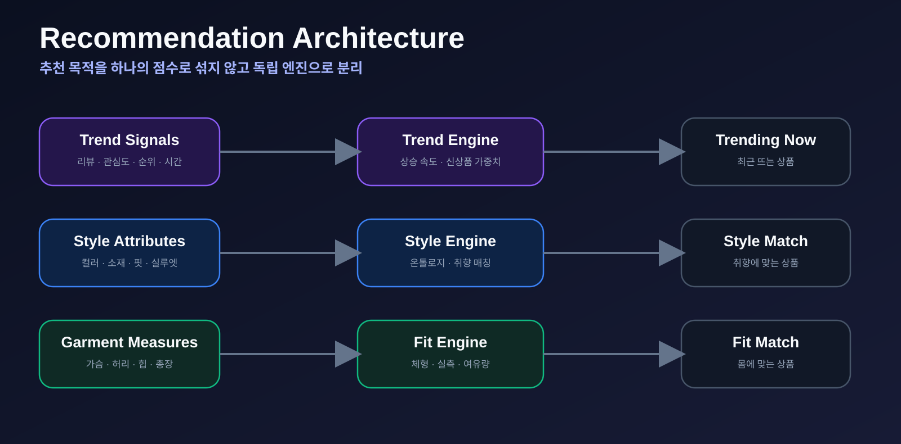
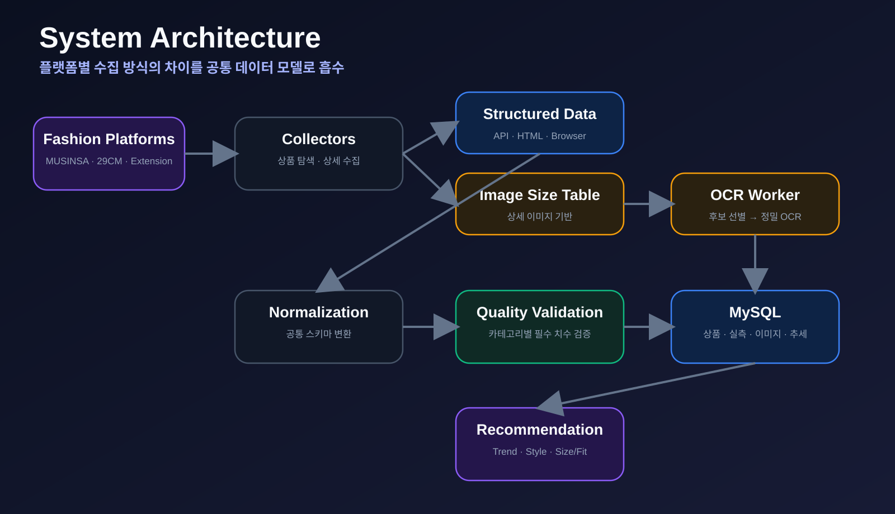
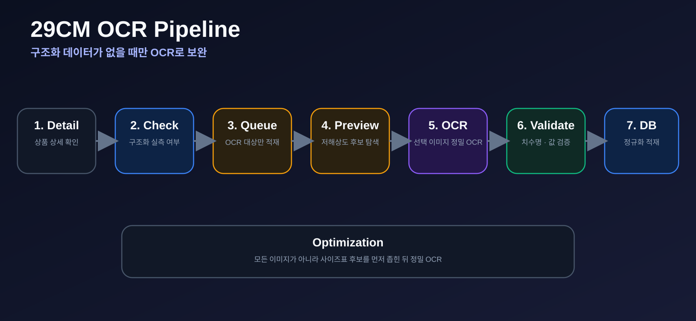
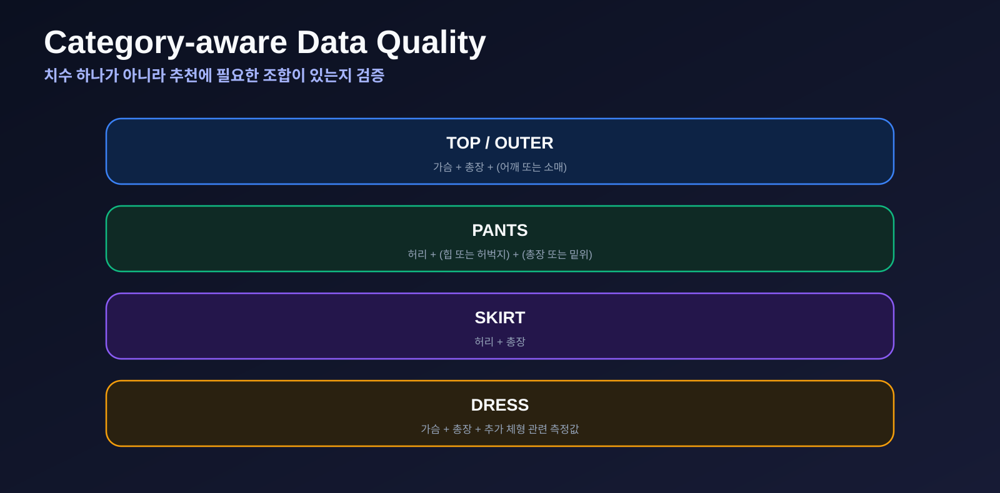
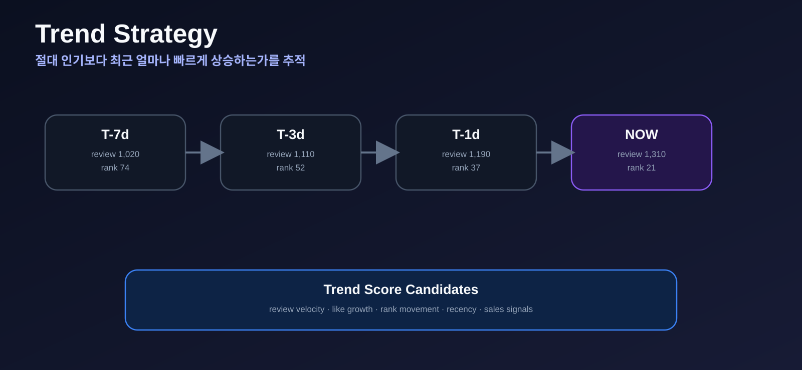
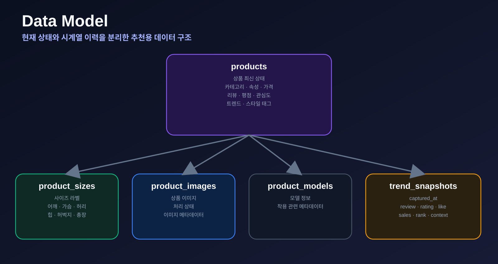

<div align="center">



<br>

[](https://www.python.org/)
[](https://www.mysql.com/)
[](https://playwright.dev/python/)
[](https://github.com/tesseract-ocr/tesseract)

### 멀티 패션 플랫폼의 서로 다른 상품 데이터를  
### **추천에 바로 사용할 수 있는 구조화 데이터**로 만드는 파이프라인

[🏗️ Architecture](#️-system-architecture) ·
[🔎 Pipeline](#-data-pipeline) ·
[🔥 Trend](#-trend-data-design) ·
[👗 Style](#-style--ontology-recommendation) ·
[📏 Fit](#-size--fit-recommendation) ·
[🗄️ Database](#️-database) ·
[🧠 Decisions](#-engineering-decisions)

</div>

---

## 📌 Project Overview

패션 플랫폼은 같은 의류를 다루더라도 상품 정보와 사이즈 정보의 제공 방식이 서로 다릅니다.

- 어떤 플랫폼은 **구조화된 실측 데이터**를 제공합니다.
- 어떤 플랫폼은 **브라우저에서 동적으로 생성되는 데이터**를 사용합니다.
- 어떤 상품은 **상세 이미지 안에 사이즈표**가 존재합니다.

이 프로젝트는 플랫폼별 데이터를 수집한 뒤 **공통 스키마로 정규화하고 품질을 검증하여 추천 시스템용 데이터로 연결**하기 위해 설계했습니다.

> **Collection → Validation → Normalization → History → Recommendation**

---

## 🎯 Goal

| 추천 | 핵심 질문 | 주요 데이터 |
|---|---|---|
| 🔥 **Trend** | 지금 무엇이 빠르게 뜨고 있는가? | 리뷰 증가량, 관심도, 판매 신호, 순위 변화 |
| 👗 **Style** | 사용자에게 어떤 스타일이 어울리는가? | 컬러, 소재, 핏, 실루엣, 패턴, TPO, 시즌 |
| 📏 **Size / Fit** | 실제 몸에 어떤 상품이 맞는가? | 상품 실측, 사용자 신체 치수, 선호 여유량 |



---

## 🏗️ System Architecture



### 설계 핵심

1. 플랫폼별 수집 로직 분리
2. API/HTML 등 구조화 데이터 우선
3. 구조화 데이터가 없을 때 OCR 보조
4. 플랫폼 데이터를 공통 스키마로 정규화
5. 추천에 사용할 수 있는지 카테고리별 품질 검증
6. 최신 상태와 시간 변화 데이터를 분리 저장

---

## 🔎 Data Pipeline

### Product Discovery

- 플랫폼 상품 ID
- 상품명 / 브랜드
- 가격 / 성별 / 카테고리
- 대표 이미지
- 상품 URL

**코드 바로 보기**

- [MUSINSA mass collector](./collectors/musinsa_mass_pipeline.py)
- [MUSINSA continuous collector](./collectors/musinsa_mass_continuous.py)
- [29CM collector](./collectors/cm29_http_fast.py)

### Detail & Size

```text
Product
├── Brand / Name / Category
├── Price / Gender
├── Color / Material / Fit
├── Stretch / Thickness
├── Images
└── Size Measurements
    ├── Shoulder / Chest
    ├── Waist / Hip / Thigh
    ├── Rise
    ├── Total Length
    └── Sleeve Length
```

---

## 🛍️ Platform Strategy

### MUSINSA

실제 상품 치수 확보를 위한 핵심 데이터 소스로 사용합니다.

- 상품 기본정보
- 카테고리 / 성별
- 컬러 / 소재 / 핏
- 평점 / 리뷰 정보
- 실제 의류 실측값

### 29CM

일부 상품은 실측표가 상세 이미지에 포함되어 있어 OCR을 보조 수단으로 사용합니다.



**저해상도 후보 탐색 → 사이즈표 가능성 판단 → 선택 이미지 정밀 OCR**

- [29CM OCR worker](./enrichers/cm29_ocr_worker.py)
- [OCR console worker](./ocr_console/worker.py)

---

## ✅ Data Quality



실측값이 하나 존재한다고 해서 추천 가능한 상품으로 보지 않습니다.  
카테고리별 최소 품질 조건을 적용하고, 누락값은 임의로 만들지 않고 `NULL`로 유지합니다.

- [Quality audit](./quality/audit_product_quality.py)

---

## 🔥 Trend Data Design

단순 누적 리뷰 수보다 **최근 얼마나 빠르게 상승하고 있는가**를 보기 위해 최신값과 과거 snapshot을 분리합니다.



### Current — `products`

```text
review_count
rating
like_count
sales_count
popularity_rank
ranking_context
trend_score
trend_updated_at
```

### History — `product_trend_snapshots`

```text
product_id
captured_at
review_count
rating
like_count
sales_count
popularity_rank
ranking_context
```

향후 계산 대상:

- 24시간 리뷰 증가량
- 7일 리뷰 증가율
- 좋아요 증가속도
- 판매 증가속도
- 인기순위 상승폭
- 신상품 가중치

---

## 📏 Size / Fit Recommendation

브랜드마다 같은 `M`이라도 실제 치수는 다를 수 있습니다.

```text
User Body Measurements
        +
Garment Measurements
        +
Category
        +
Preferred Ease
        ↓
      Fit Score
```

사이즈 이름보다 **실제 의류 치수**를 중심으로 추천하는 것이 목표입니다.

---

## 👗 Style / Ontology Recommendation

추천 속성 예시:

```text
Color
Material
Fit
Silhouette
Pattern
Neckline
Season
TPO
Style Tags
```

목표는 단순 유사도 추천을 넘어 **왜 추천했는지 설명 가능한 구조**를 만드는 것입니다.

---

## 🗄️ Database



| Table | 역할 |
|---|---|
| `products` | 상품 최신 상태 및 추천 속성 |
| `product_sizes` | 사이즈별 실제 의류 실측 |
| `product_images` | 상품 이미지 정보 |
| `product_models` | 모델 착용 관련 정보 |
| `product_trend_snapshots` | 인기 지표의 시간 변화 |

[📄 DB schema 바로 보기](./sql/schema.sql)

---

## 📂 Project Structure

```text
fashion-data-pipeline/
├── collectors/      # 플랫폼별 수집
├── core/            # 공통 설정 / 기본 수집 로직
├── loaders/         # MySQL 적재 / 정규화
├── enrichers/       # 이미지 / OCR / 추가정보 보강
├── quality/         # 데이터 품질 검증
├── ocr_console/     # OCR queue / worker
├── pipelines/       # 반복 실행 스크립트
├── sql/             # DB schema
├── assets/          # README 시각화
├── .env.example
├── requirements.txt
└── README.md
```

### Quick Links

| Area | Link |
|---|---|
| MUSINSA 수집 | [열기](./collectors/musinsa_mass_pipeline.py) |
| 29CM 수집 | [열기](./collectors/cm29_http_fast.py) |
| OCR | [열기](./enrichers/cm29_ocr_worker.py) |
| 공통 적재 | [열기](./loaders/loader.py) |
| 품질 검증 | [열기](./quality/audit_product_quality.py) |
| DB schema | [열기](./sql/schema.sql) |
| Pipeline scripts | [열기](./pipelines/) |

---

## 🛠️ Tech Stack

| Area | Technology |
|---|---|
| Language | Python, SQL, Bash |
| Browser Automation | Playwright |
| HTTP / Parsing | Requests, BeautifulSoup |
| Database | MySQL, PyMySQL |
| OCR | Tesseract OCR |
| Image | Pillow |
| Infra | Linux / Ubuntu |
| Cloud SDK | OCI |

---

## ⚙️ Setup

```bash
git clone https://github.com/mepics2425-prog/fashion-data-pipeline.git
cd fashion-data-pipeline

python -m venv .venv
source .venv/bin/activate

pip install -r requirements.txt
python -m playwright install chromium

cp .env.example .env
```

DB 구조는 [`sql/schema.sql`](./sql/schema.sql)로 재현할 수 있습니다.

---

## 🧠 Engineering Decisions

### 01. Collection과 Recommendation 분리
플랫폼이 늘어나도 추천 계층이 영향을 덜 받도록 Collector와 공통 모델을 분리했습니다.

### 02. Structured Data First
API/HTML에서 구조화된 값을 얻을 수 있다면 OCR보다 우선합니다.

### 03. OCR as Fallback
이미지에만 존재하는 실측표를 위해 OCR을 사용하되 후보 이미지를 먼저 좁힙니다.

### 04. Raw Data Preservation
파싱 규칙 변경 시 불필요한 재수집을 줄일 수 있도록 원본 응답 보존을 고려했습니다.

### 05. Preserve Uncertainty
누락값을 임의의 값으로 채우지 않습니다.

### 06. Current State ≠ Trend
현재 인기와 최근 상승세를 구분하기 위해 최신값과 snapshot을 분리합니다.

---

## 🛣️ Roadmap

- [x] MUSINSA 상품 수집 구조
- [x] 상품 실측 데이터 적재
- [x] 29CM 수집 구조
- [x] OCR worker
- [x] 데이터 품질 검증
- [x] MySQL 정규화
- [x] Trend snapshot schema
- [ ] Trend Score 고도화
- [ ] 패션 Ontology 확장
- [ ] 이미지 기반 Style Attribute 추출
- [ ] User Body Profile
- [ ] Category별 Ease Rule
- [ ] Fit Score
- [ ] Style Matching
- [ ] Recommendation API
- [ ] Dashboard

---

## 🔐 Security

공개 저장소에는 실제 DB 비밀번호, API Key, SSH Key, `.env`, 사용자 정보, 운영 서버 주소, 대규모 원본 데이터를 포함하지 않습니다.

---

<div align="center">

### From fragmented fashion data  
### to recommendation-ready structured data.

[⬆ Back to top](#fashion-data-pipeline)

</div>
